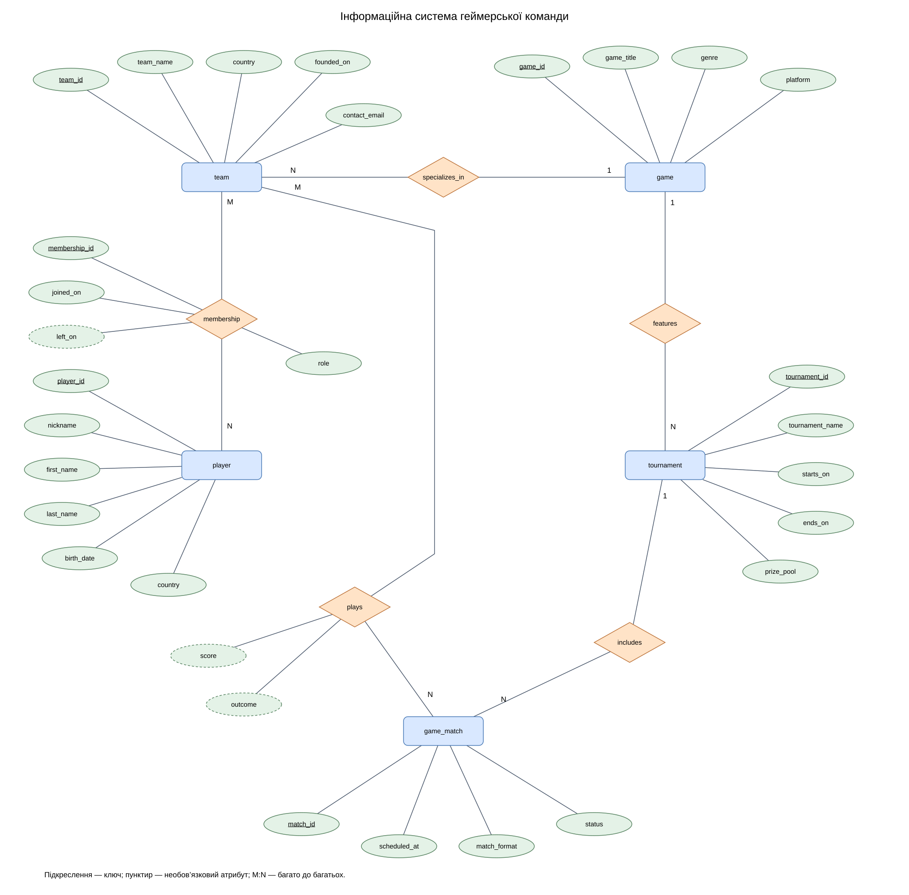

# Лабораторна робота 2
## Інформаційна система геймерської команди

### Мета роботи
Проаналізувати предметну область, визначити інформаційні об’єкти та їхні атрибути, побудувати концептуальну ER-модель і логічну схему бази даних.

### 1 Опис предметної області
Система призначена для менеджера геймерської команди. Вона зберігає дані про гравців, історію складу команд, ігрові дисципліни, турніри, розклад матчів і результати. Інші команди потрібні для обліку суперників. У навчальній моделі одна команда представляє склад з однієї гри; для організації з кількома дисциплінами створюються окремі команди.

Менеджер реєструє гравців і зміни складу, аналітик переглядає результати, а капітан використовує розклад матчів. Облік контрактних сум, тренувань, спонсорів та окремих карт матчу не входить до меж цієї моделі.

### 2 Інформаційні потреби
1. Які гравці входять до поточного складу команди?
2. Які ролі виконують гравці та коли приєдналися до команди?
3. У яких командах гравець перебував раніше?
4. У якій грі спеціалізується команда?
5. Які матчі заплановано для команди на заданий період?
6. Які суперники, рахунки та результати завершених матчів?
7. Скільки перемог і поразок має команда в турнірі?

### 3 Концептуальна модель


[Редагувати діаграму у draw.io](Gaming_Team_ER.drawio)

Світло-сині прямокутники — сутності; персикові ромби — зв’язки; зелені овали — атрибути. Підкреслення позначає ключ, пунктир — необов’язковий атрибут. Числа 1, M та N показують максимальну кратність. Мінімальна участь визначена нижче.

### 4 Сутності та атрибути
| Сутність | Атрибути | Призначення |
|---|---|---|
| player | player_id, nickname, first_name, last_name, birth_date, country | Відомості про гравця |
| team | team_id, team_name, country, founded_on, contact_email | Команда з однієї ігрової дисципліни |
| game | game_id, game_title, genre, platform | Гра та платформа проведення змагань |
| tournament | tournament_id, tournament_name, starts_on, ends_on, prize_pool | Турнір з однієї гри |
| game_match | match_id, scheduled_at, match_format, status | Матч у межах турніру |

Зв’язок **membership** має атрибути membership_id, joined_on, left_on, role. Він описує окремий період перебування гравця в команді. Повторне приєднання створює новий період із новим membership_id. Це зв’язок з власною ідентичністю; у логічній схемі він стає асоціативною таблицею.

Зв’язок **plays** має атрибути score та outcome. Вони належать конкретній команді в конкретному матчі. У логічній схемі він стає таблицею match_team зі складеним ключем.

### 5 Зв’язки та їхня кратність
| Зв’язок | Сутності | Кратність | Правило |
|---|---|---|---|
| specializes_in | team — game | N:1 | Команда представляє одну гру; гра може мати багато команд |
| membership | player — team | M:N | Гравець може змінювати команди; команда має багато гравців |
| features | game — tournament | 1:N | Турнір присвячений одній грі; гра має багато турнірів |
| includes | tournament — game_match | 1:N | Матч належить одному турніру; турнір містить багато матчів |
| plays | team — game_match | M:N | Команда бере участь у багатьох матчах; матч має дві команди |

Гравця дозволено зареєструвати до включення у склад. Команда може не мати гравців або матчів під час створення. Гра може не мати команд чи турнірів; турнір — матчів. Кожна команда обов’язково має гру, кожний турнір — гру, кожний матч — турнір. Запланований матч може мати 0–2 визначені команди; перед початком потрібні рівно дві різні команди. Загальна кратність N на діаграмі уточнюється цим бізнес-правилом.

### 6 Логічна схема бази даних
PK — первинний ключ; FK — зовнішній ключ; UQ — унікальне значення; NULL — необов’язкове поле. Усі інші поля обов’язкові.

```text
game (
  game_id PK, game_title, genre, platform,
  UQ(game_title, platform)
)
team (
  team_id PK, game_id FK -> game.game_id,
  team_name, country, founded_on, contact_email
)
player (
  player_id PK, nickname UQ, first_name, last_name, birth_date, country
)
membership (
  membership_id PK,
  player_id FK -> player.player_id,
  team_id FK -> team.team_id,
  joined_on, left_on NULL, role,
  UQ(player_id, team_id, joined_on)
)
tournament (
  tournament_id PK, game_id FK -> game.game_id,
  tournament_name, starts_on, ends_on, prize_pool
)
game_match (
  match_id PK, tournament_id FK -> tournament.tournament_id,
  scheduled_at, match_format, status
)
match_team (
  match_id PK FK -> game_match.match_id,
  team_id PK FK -> team.team_id,
  score NULL, outcome NULL
)
```

Foreign keys додані під час переходу до логічної моделі. На концептуальній діаграмі відповідні залежності показано ромбами, тому ці FK не дублюються окремими овалами.

### 7 Типи даних
| Поля | Тип та обмеження |
|---|---|
| Усі ідентифікатори | INTEGER; PK унікальний та NOT NULL |
| nickname | VARCHAR(50), UNIQUE |
| Назви, імена, країни, роль, жанр, платформа | VARCHAR відповідної довжини |
| contact_email | VARCHAR(254); перевірка базової структури адреси |
| birth_date, founded_on, joined_on, left_on, starts_on, ends_on | DATE |
| scheduled_at | TIMESTAMP; узгоджений часовий пояс системи |
| prize_pool | DECIMAL(14,2), значення ≥ 0; усі суми в USD |
| match_format | VARCHAR(10): BO1, BO3 або BO5 |
| status | VARCHAR(20): scheduled, ongoing, completed, cancelled |
| score | INTEGER ≥ 0 або NULL; кількість виграних карт |
| outcome | VARCHAR(10): win, loss або NULL |

### 8 Обмеження цілісності
1. Дата завершення турніру не раніше початку. Дата виходу зі складу, якщо задана, не раніше дати вступу. Дата народження передує даті вступу.
2. left_on = NULL означає відкритий період членства. Періоди перебування одного гравця у командах однієї гри не перетинаються. Гравець може одночасно представляти різні ігри.
3. Для запланованого матчу score та outcome відсутні. Під час матчу score може заповнюватися; outcome визначається після завершення.
4. Перед початком і після завершення матч має рівно дві різні команди. Команди повинні представляти ту саму гру, що й турнір.
5. Для завершеного матчу один outcome дорівнює win, другий — loss. Нічиї у вибраній моделі не передбачені.
6. У форматі BO1 переможець має 1 виграну карту; BO3 — 2; BO5 — 3. Рахунок суперника менший за переможний. Технічні перемоги у межі моделі не входять.
7. Матч проводиться в межах дат турніру. Перевірка застосовується до дати scheduled_at в узгодженому часовому поясі.
8. Складений PK(match_id, team_id) забороняє повторне включення тієї самої команди в матч. Видалення записів, на які посилається історія матчів або складів, блокується.
9. Кількість команд матчу, сумісність дисциплін, узгодження рахунку та перетини періодів перевіряються транзакційною логікою або тригерами. Звичайного CHECK одного рядка для цих правил недостатньо.

### 9 Контрольні приклади
- Гравець вступив у команду 01.09.2026 і вийшов 01.10.2026. Повторний вступ 15.10.2026 створює новий запис membership, зберігаючи історію.
- Для матчу BO3 рахунок 2:1 і результати win/loss допустимі. Рахунок 3:1 для BO3 відхиляється.
- Включення третьої команди або команди з іншої гри блокується перед початком матчу.

Це сценарії перевірки моделі, а не твердження про виконання SQL-коду.

### 10 Висновок
Розроблено концептуальну модель з п’ятьма сутностями та п’ятьма зв’язками. У логічній схемі зв’язки з атрибутами перетворено на membership і match_team, тому утворено сім таблиць. Модель зберігає історію складів, розклад турнірів і результати команд без дублювання відомостей про гравців та ігри.

### Файли та завантаження до GitHub
Розмістіть README.md, Gaming_Team_ER.drawio.png та Gaming_Team_ER.drawio в одній папці LAB-2 репозиторію предметної області. Тоді діаграма та посилання вище працюватимуть за відносними шляхами. Матеріали company залишаються в SQL-LAB; ця модель призначена для окремої предметної області.

Джерело вимог до структури роботи — надана методичка Lab 2.pdf. Предметну область і бізнес-правила розроблено як навчальну модель.
